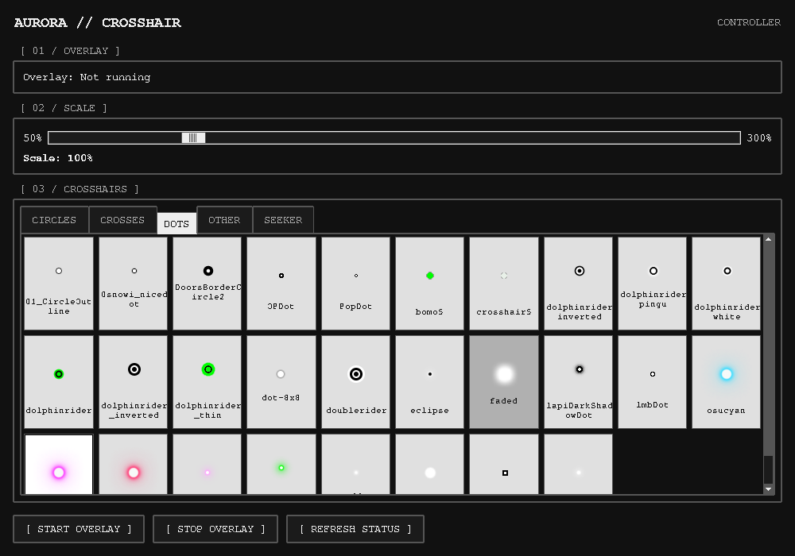

# Aurora Crosshair Overlay

A Windows crosshair overlay with a C++ Win32/GDI/WIC renderer and a Python/Tk
controller. It displays transparent PNG crosshairs, stays above other windows,
and lets clicks pass through without activating itself. The existing DirectX
classes remain in the project as legacy code; the active entry point uses
`UpdateLayeredWindow` and Windows desktop composition.

Use windowed or borderless-windowed games. True exclusive fullscreen is not
supported. Compatibility with a particular game's protection policy is not
implied, and this project does not inject into games, hook input or bypass
protections.

## Run on Windows

Requirements: Windows 10/11 x64, Python 3.10+ with Tk, Pillow 9.1+ and psutil 5.9+.
Building requires Visual Studio 2022's Desktop development with C++ workload
(v143), a Windows SDK and C++17.

From the repository root:

```powershell
python -m pip install -r CrosshairGUI/requirements.txt
msbuild AuroraCrosshairDX.sln /p:Configuration=Release /p:Platform=x64
python CrosshairGUI/gui.py
```

Run `msbuild` in a Visual Studio developer shell. See [the build guide](BUILD_GUIDE.md)
for output layout, tests and release packaging. `CrosshairGUI/run_gui.bat` starts
Python without reinstalling dependencies on every launch.

The controller discovers PNGs in the repository's
`AuroraCrosshairDX/resources/crosshairs` categories, including nested folders.
Categories load previews when opened. Select an image and adjust its scale from
50% to 300%. The GUI can be minimized or closed while the overlay continues;
closing flushes pending settings and does not stop the overlay. Use Stop Overlay
or close the overlay explicitly to stop it.

The controller uses a monochrome terminal-style interface with monospace text.
Crosshair previews retain their original image colors and transparency.



Settings retain the two-key text format described in [CONFIGURATION.md](CONFIGURATION.md).
The default config base remains `%USERPROFILE%\Documents\Crosshair overlay`.
`AURORA_OVERLAY_HOME` can select another base directory for both processes.
Saved settings are restored when reopening the GUI.

## Performance work

The overlay redraws on changes instead of continually presenting an unchanged
image. It retains graphics resources and uses a bounded crosshair surface. The
controller coalesces slider updates and publishes complete config files atomically.
These changes preserve the C++ renderer/Python GUI architecture and add no
permanent worker service, input hook or animation loop.

A static overlay can still affect Windows/game composition and frame pacing.
**No zero-impact, Windows FPS or input-latency claim is made.** The current
Linux build and GUI tests do not establish native rendering or gameplay quality.

- [Original technical audit and top five changes](docs/PERFORMANCE_AUDIT.md)
- [Benchmark protocol and measurement commands](docs/PERFORMANCE.md)
- [Recorded validation and available measurements](docs/VALIDATION.md)

The Qt/CMake controller, `main_v2.cpp`, and `test_dx.cpp` are legacy/experimental.
They are not used by the primary Python-controller workflow. In particular,
`test_dx.cpp` is an uncapped interactive test, not a performance benchmark.

Historical project summaries and roadmaps describe older implementations and
contain unverified performance claims. Use this README, the build/configuration
guides, and the performance documents for the current implementation.

This project is provided as-is for personal use.
